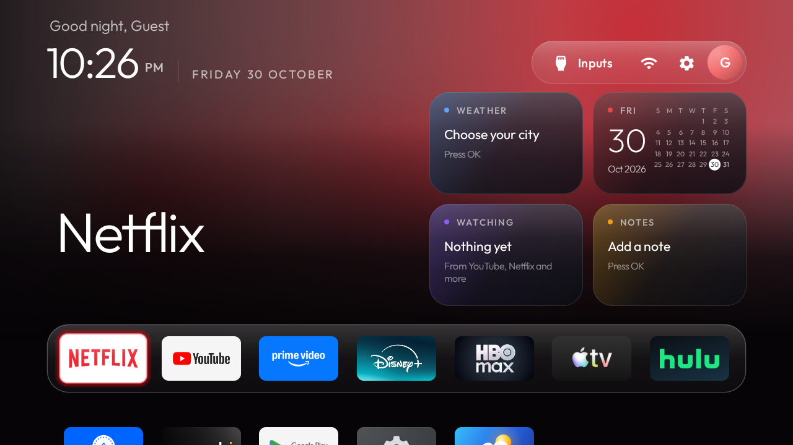
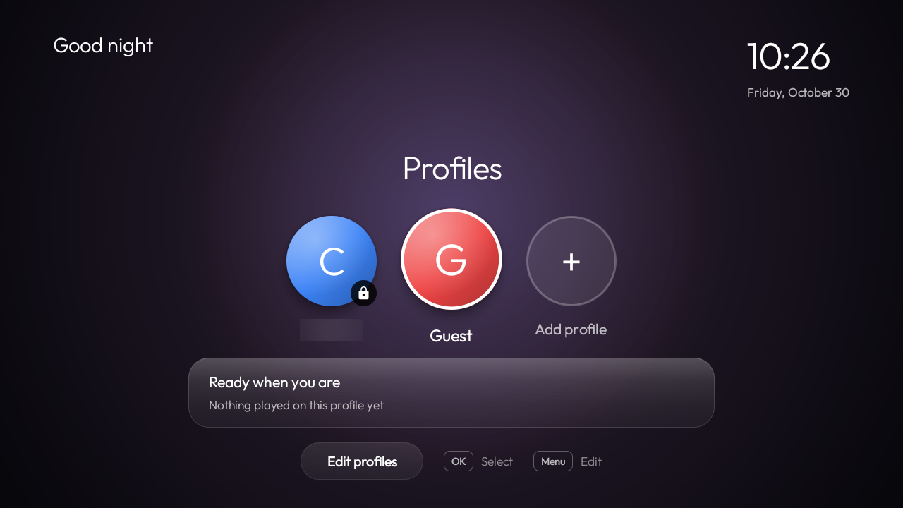
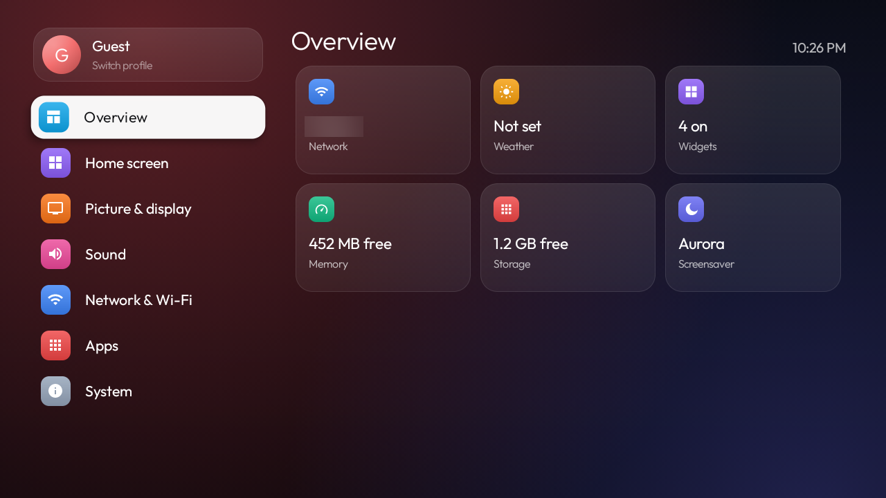
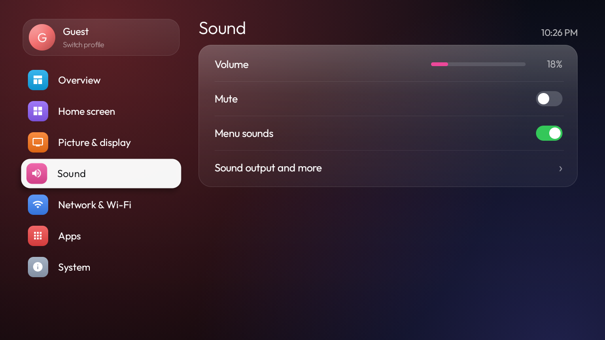
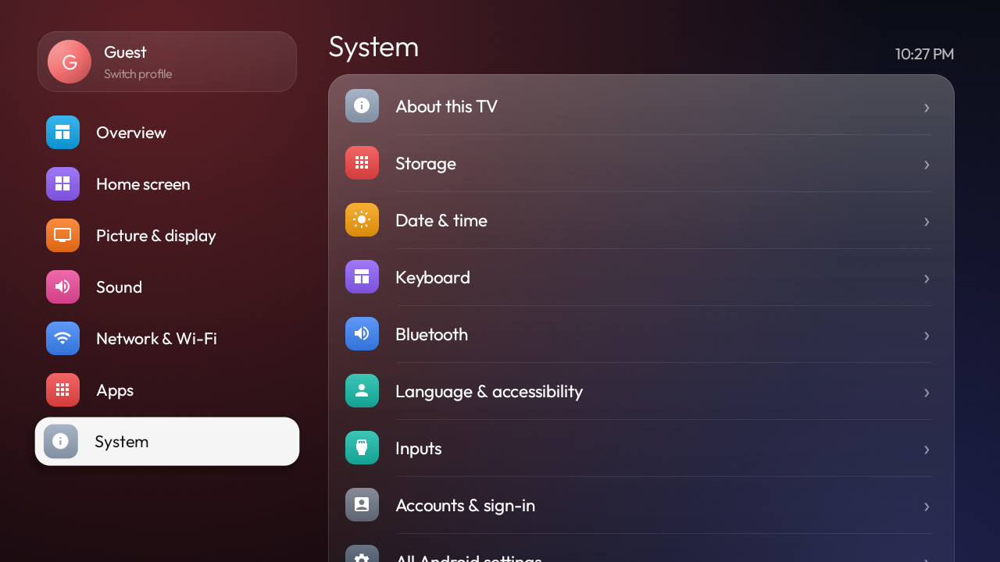

<div align="center">

# TVOS

**A calm, fast home screen for Android TV, installed by Claude Code.**

Profiles, widgets, a new Settings app, Weather and a keyboard made for the remote, built to run on a TV with 1.5 GB of RAM.

[Install](#install) · [What you get](#what-you-get) · [Is it safe?](#is-it-safe) · [Undo](#undo)



</div>

> TVOS is an unofficial community project. It isn't made by, or connected to, Apple, Google or any TV maker.

## What you get

| | |
|---|---|
| **Startup screen** | "Who's watching?" with avatars, PINs, the clock, the weather and where each person left off |
| **Home** | Your apps in a glass dock, plus widgets for weather, calendar, notes and what you were watching |
| **Settings** | Two panes that follow your remote, with pages for network, sound, picture, apps, storage, Bluetooth and more |
| **Weather** | The week, sunrise and sunset, and a 12-hour temperature graph, with no account needed |
| **TV Keyboard** | A D-pad keyboard that works offline and keeps no history |
| **Clean-up** | Removes the clutter and tracking your TV shipped with, by disabling apps instead of deleting them |

<table>
<tr>
<td width="50%"><br><sub>Startup screen</sub></td>
<td width="50%"><br><sub>Settings overview</sub></td>
</tr>
<tr>
<td width="50%"><br><sub>Sound settings</sub></td>
<td width="50%"><br><sub>System settings</sub></td>
</tr>
</table>

## Install

You need [Claude Code](https://claude.com/claude-code), an Android TV or Google TV running Android 8 or newer, and a
computer on the same network. You also need JDK 17 and the Android SDK, because TVOS is built from source on your
computer. Claude tells you if anything is missing.

First turn on the TV's debugging mode: **Settings → Device Preferences → About**, press OK on **Build** 7 times, then
turn on **USB debugging** in Developer options, plus Network or Wireless debugging if your TV shows them.

### Option 1: the Claude Code plugin

```text
/plugin marketplace add Randomstufteam/TVOS
/plugin install tvos@tvos
/tvos:install
```

### Option 2: paste the prompt

Open the [latest release](https://github.com/Randomstufteam/TVOS/releases/latest), copy the text from `PROMPT.md`, add
your TV's model and paste it into Claude Code.

Either way, Claude gathers the files from that exact release, builds TVOS, installs it and checks it with you. It asks
before changing anything your household uses, such as streaming apps or the voice assistant.

## Is it safe?

- **Nothing is deleted.** Apps are disabled, never uninstalled, and there's no rooting or flashing.
- **Backup first.** Claude saves your TV's app list and settings before the first change.
- **Protected packages.** The clean-up tools refuse lists that would disable parts of Android the TV needs to start.
- **Your data stays local.** TVOS has no account, no analytics and no ads. Its only network use is the weather, from
  [Open-Meteo](https://open-meteo.com), and only once you choose a place.
- **PINs are a privacy screen, not a lock.** They keep a profile tidy and private, but apps keep their own accounts.

**It's been tested on one TV so far:** a Hisense set on Android 11 with Google TV. Other TVs should work, but remotes
and firmware differ, so expect Claude to adjust settings for yours. TVOS comes with no warranty.

## Undo

Every disabled app can be turned back on. Claude gives you a restore script at the end, and
[docs/restore.md](docs/restore.md) explains how it works.

## What's in here

| Path | What it is |
|---|---|
| `PROMPT.md` | The prompt that installs TVOS |
| `skills/install/` | The same steps as a Claude Code skill |
| `launcher/` | TVOS itself: plain Java, built from source |
| `scripts/install-tvos.sh` | Builds, installs and sets up TVOS |
| `tools/` | ADB client, backup, clean-up and restore tools |
| `docs/` | The full procedure, troubleshooting and restore guides |

## Credits

TVOS is built on [cleanyourtv](https://github.com/Gathin23/cleanyourtv) by Gathin, which is where its launcher, safety
rules and tools come from. Thank you. Released under the [MIT License](LICENSE). The Outfit font (OFL) and Fluent Emoji
artwork (MIT) keep their own licences, in `launcher/`.
